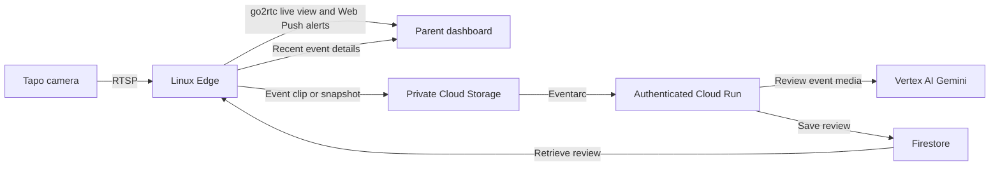
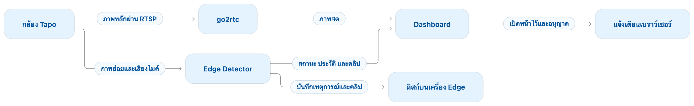

# LullabAI Twins

LullabAI Twins ทำงานบนเครื่อง Edge และเครือข่ายในบ้าน กล้องส่งภาพและเสียงผ่าน RTSP เครื่อง Edge ตรวจจับเหตุการณ์ และ Dashboard แสดงภาพสดกับประวัติของแต่ละเตียง

## Architecture with GCP



The Edge monitor detects events and sends the initial alert immediately. When GCP is enabled, it uploads one recording for each new camera event and adds Gemini’s review to **Recent events**. A failed review leaves the original Edge alert available. The bucket and Firestore have seven-day retention policies. Live streams are served by the Linux PWA.

## Architecture without GCP (Temporary)



- **ภาพสด** ใช้ go2rtc: บน LAN แบบ HTTP ลอง WebRTC ก่อน ส่วน HTTPS ที่ใช้ proxy โดเมนเดียวกันลอง MSE ผ่าน WebSocket ก่อน แล้วใช้ MJPEG หากเล่นวิดีโอไม่ได้
- **การตรวจจับ** ใช้ภาพและเสียงจากกล้องที่ Edge โมเดล YAMNet ประมวลผลเสียงบนเครื่องและแจ้งเตือนเมื่อพบเสียงคล้ายเด็กร้องไห้หรือเสียงสุนัข เช่น เห่าหรือคราง
- **ประวัติ** บันทึก JSON ลงโฟลเดอร์ `edge/local_events/` และกู้คืนได้หลังรีสตาร์ต หน้าเว็บแสดง 3 รายการล่าสุดต่อเตียง กด **See more** เพื่อดูเพิ่มได้สูงสุด 15 รายการต่อเตียง
- **คลิป** บันทึกภาพจากบัฟเฟอร์ก่อนและหลังเหตุการณ์ลง `edge/local_events/media/` คลิปแจ้งเตือนเสียงรายการใหม่จะมีเสียงจากไมค์เมื่อกล้องส่งเสียงได้ ตั้งระยะเวลาเก็บวิดีโอได้จาก **Settings → Video retention**
- **แจ้งเตือน** เปิดรับแจ้งเตือนขณะหน้าเว็บเปิดได้บน `localhost` หรือ HTTPS เมื่อเปิด Web Push ตามขั้นตอนด้านล่าง Edge จะส่งแจ้งเตือนไปยังมือถือที่สมัครไว้ได้แม้ปิดหน้าเว็บ
- เปิดโหมดนี้โดยใช้ `docker-compose.yml` ตามปกติ

## Local video retention

Open **Settings → Video retention** from the dashboard on HTTPS or localhost. Choose **1, 3, 7, 14, 30, or 90 days**, enter the Edge setup code from `WEB_PUSH_SETUP_CODE`, and select **Apply and delete expired videos**. The default is **Keep forever**. The setting applies to both beds and persists across restarts.

Edge checks local videos at startup, after a setting change, and hourly. Enabling retention can permanently delete videos already older than the selected limit. Event history and snapshots stay available. Cloud copies follow the existing GCP retention policy.

## Enable GCP reviews on Linux

The deployment script defaults to project `twins-monitor`, deployment account `mils.burasakorn@gmail.com`, and region `asia-southeast1` for Cloud Storage, Firestore, and Cloud Run. Gemini uses the Vertex AI global endpoint.

1. Deploy or update the cloud resources from the repository root. The project must have billing enabled.

   ```bash
   gcloud auth login mils.burasakorn@gmail.com --no-activate
   bash cloud/infra/setup_gcp.sh
   ```

2. Supply Application Default Credentials for `lullabai-edge@twins-monitor.iam.gserviceaccount.com` on the Linux Edge host. For an interactive setup, the deployment account can create impersonated ADC without a service-account key. Sign in as `mils.burasakorn@gmail.com` in the Google window.

   ```bash
   cd edge
   (
     umask 077
     mkdir -p cloud-secrets
     export CLOUDSDK_CONFIG="$(mktemp -d)"
     trap 'rm -rf "$CLOUDSDK_CONFIG"' EXIT
     gcloud auth application-default login \
       --disable-quota-project \
       --impersonate-service-account=lullabai-edge@twins-monitor.iam.gserviceaccount.com
     cp "$CLOUDSDK_CONFIG/application_default_credentials.json" cloud-secrets/adc.json
   )
   ```

   On a headless Linux host, add `--no-browser` to the login command and follow the remote sign-in instructions it prints. For an unattended setup with an identity provider, set `LULLABAI_GCP_ADC_FILE` to a credential configuration readable inside the container. Mount any credential files it references at the corresponding container paths. [Workload Identity Federation](https://docs.cloud.google.com/iam/docs/workload-identities)

3. Set `WEB_PUSH_SETUP_CODE` in `edge/.env` if you do not already have an Edge setup code. You can generate one with `openssl rand -hex 24`. From `edge/`, start the detector with access to GCP.

   ```bash
   docker compose -f docker-compose.yml -f docker-compose.gcp.yml up -d --build
   ```

4. Open **Settings → Event analysis** from the dashboard on HTTPS or localhost. Choose **GCP review** or **Local only**, enter the Edge setup code, and select **Apply mode**. The preference applies to both beds and persists across restarts. A fresh Edge installation starts in **Local only**.

**GCP review** uploads new events and shows Gemini's results in **Recent events**. **Local only** stops new uploads and cloud polling. Events recorded in Local only mode and unfinished reviews from an earlier session stay out of the upload queue when GCP is re-enabled. Previously submitted jobs can still finish, and existing cloud storage and other deployed resources can still incur charges. [Cloud Run pricing](https://cloud.google.com/run/pricing) · [Cloud Storage pricing](https://cloud.google.com/storage/pricing)

## เริ่มใช้งานด้วยกล้อง Tapo

1. ตั้ง Camera Account ในแอป Tapo แล้วคัดลอก `edge/.env.example` เป็น `edge/.env` หากมีไฟล์เดิมอยู่แล้วให้ใช้ค่าที่ตั้งไว้
2. ตั้ง `BABY_1_MAIN_RTSP` เป็น `stream1` สำหรับภาพสด และ `BABY_1_SUB_RTSP` เป็น `stream2` สำหรับตรวจจับภาพและเสียง ค่า `SUBJECT_MODE` รองรับ `BABY` และ `PET_TEST`
3. รัน Docker Compose จากโฟลเดอร์ `edge/` และรันเว็บจากโฟลเดอร์ `web/`

```bash
# Terminal 1
cd edge
docker compose up -d --build

# Terminal 2
cd web
npm ci
npm run dev
```

- Dashboard เปิดที่ `http://localhost:5173` บนเครื่อง Edge หรือ `http://<IP-เครื่อง-Edge>:5173` บนอุปกรณ์ในเครือข่ายเดียวกัน
- go2rtc ใช้พอร์ต 1984 และ Edge API ใช้พอร์ต 8095 โดยดูสถานะได้ที่ `http://localhost:8095/status`
- สามารถตั้ง URL เองด้วย `VITE_GO2RTC_URL`, `VITE_EDGE_BASE_URL`, `VITE_EDGE_STATUS_URL` และ `VITE_MOCK_CAMERA_URL`
- Dashboard บน HTTPS ใช้ reverse proxy บนโดเมนเดียวกันที่ `/edge`, `/go2rtc` และ `/mock` ตามตัวอย่างด้านล่าง สำหรับ Cloudflare Tunnel ที่ชี้มาที่ Vite preview ให้ใช้ `web/vite.config.ts` ด้วย (มี proxy และ WebSocket สำหรับภาพสด) และคง Cloudflare Access ครอบคลุมทุกเส้นทาง

## Deploy บน Linux และเปิด Web Push

Edge ส่งแจ้งเตือนผ่าน Web Push ไปยังเบราว์เซอร์ที่สมัครไว้ ส่วนภาพและคลิปอยู่บนเครื่อง Linux ข้อความแจ้งเตือนมีชื่อเหตุการณ์และเตียงที่ตรวจพบ (เมื่อเปิด **GCP review** ระบบจะรอให้ Vertex AI Gemini ยืนยันเหตุการณ์ก่อนส่งแจ้งเตือน และกรองเสียงร้อง/การขยับตัวให้ต่อเนื่องอย่างน้อย 10 วินาทีก่อนส่งขึ้น Vertex AI ส่วนเหตุการณ์ความปลอดภัยเช่นพลิกคว่ำ/ผ้าปิดหน้าจะส่งทันที) Edge เก็บข้อมูลสมัครรับบนดิสก์ใน `edge/local_events/push_subscriptions.sqlite3`

### วิธี Deploy อัตโนมัติด้วยสคริปต์ (แนะนำ)

ตั้งค่า `edge/.env` ให้เรียบร้อยก่อน (รวมถึง `LULLABAI_BIND_ADDRESS=127.0.0.1`, `WEB_PUSH_SUBJECT`, `WEB_PUSH_SETUP_CODE`) แล้วรันจากรากโปรเจกต์:

```bash
# Deploy ทั้ง Edge (ตรวจหา edge/cloud-secrets/adc.json อัตโนมัติ) + บิลด์หน้าเว็บไปที่ /srv/lullabai
bash edge/deploy_linux.sh --web-dir /srv/lullabai

# ตัวเลือกเพิ่มเติม:
# bash edge/deploy_linux.sh --pull --gcp --web-dir /srv/lullabai   # ดึงโค้ดล่าสุด + บังคับโหมด GCP
# bash edge/deploy_linux.sh --local --skip-web                     # รันเฉพาะ Edge แบบ Local
```

สคริปต์จะสร้าง `edge/push-secrets/vapid.pem` อัตโนมัติเฉพาะครั้งแรก (ไม่ทับไฟล์เดิมเพื่อให้มือถือที่สมัครไว้รับแจ้งเตือนต่อได้), สตาร์ต Docker Compose, บิลด์ `web/dist/` และตรวจสอบ `/health` ให้ครบจบในคำสั่งเดียว

### ขั้นตอนแบบ Manual และตัวอย่าง Caddy Reverse Proxy

1. สร้างคีย์ VAPID และรหัสสมัครรับแจ้งเตือนจากโฟลเดอร์ `edge/` สร้างคีย์ครั้งแรกแล้วใช้ไฟล์เดิมหลังรีสตาร์ตหรืออัปเดต เพื่อให้มือถือที่สมัครไว้รับแจ้งเตือนได้ต่อ

   ```bash
   cd edge
   mkdir -p push-secrets
   (umask 077; test -e push-secrets/vapid.pem || openssl ecparam -name prime256v1 -genkey -noout -out push-secrets/vapid.pem)
   openssl rand -hex 24
   ```

2. เพิ่มค่าต่อไปนี้ใน `edge/.env` แล้วรัน `docker compose up -d --build` ใช้อีเมลติดต่อของคุณและนำผลจากคำสั่ง `openssl rand` มาใส่เป็น setup code

   ```dotenv
   LULLABAI_BIND_ADDRESS=127.0.0.1
   WEB_PUSH_SUBJECT=mailto:you@example.com
   WEB_PUSH_SETUP_CODE=<your-generated-setup-code>
   ```

3. รัน `npm ci` และ `npm run build` ใน `web/` แล้วให้ HTTPS reverse proxy เสิร์ฟไฟล์จาก `web/dist/` พร้อมป้องกันทั้งหน้าและเส้นทางกล้องด้วยการล็อกอิน ตัวอย่างด้านล่างใช้ Caddy บนเครื่อง Linux เดียวกับ Docker เปลี่ยนโดเมน ไดเรกทอรี และ hash จาก `caddy hash-password` ให้ตรงกับเครื่องของคุณ

   ```caddyfile
   monitor.example.com {
       basic_auth {
           parent <paste-password-hash>
       }

       @foreignSocket {
           path /go2rtc/*
           header Upgrade websocket
           not header Origin https://monitor.example.com
       }
       respond @foreignSocket 403

       handle /push/* {
           reverse_proxy 127.0.0.1:8095
       }
       handle_path /edge/* {
           reverse_proxy 127.0.0.1:8095
       }
       handle_path /go2rtc/* {
           reverse_proxy 127.0.0.1:1984
       }
       handle_path /mock/* {
           reverse_proxy 127.0.0.1:8090
       }
       handle {
           root * /srv/lullabai
           file_server
       }
   }
   ```

4. เปิด URL แบบ HTTPS บนมือถือ แล้วกด **Add to Home Screen** บน Dashboard หากเบราว์เซอร์ไม่เปิดหน้าต่างติดตั้ง ให้ทำตามวิธีในเมนูที่แสดงใต้ปุ่ม (บน iPhone/iPad ใช้ **Share → Add to Home Screen** ใน Safari) จากนั้นเปิดจากไอคอนที่เพิ่มไว้ เข้าเมนูกระดิ่ง กรอก setup code แล้วกด **Enable background alerts** และอนุญาต สิทธิ์ตั้งค่าแยกตามเครื่อง

Edge ต้องเชื่อมอินเทอร์เน็ตเพื่อส่งข้อความไปยังผู้ให้บริการ Web Push ของเบราว์เซอร์ เมื่อแตะแจ้งเตือน PWA จะเปิดเตียงที่รายงานเหตุการณ์

## โหมดทดสอบ

ถ้ายังไม่ตั้ง RTSP จริง ระบบใช้ `mock-camera` บนพอร์ต 8090 และสามารถเปิดโหมดจำลองจากเมนูตั้งค่าบน Dashboard ได้ ทดสอบเฉพาะ Edge โดยใช้คำสั่งนี้จากรากโปรเจกต์

```bash
.venv/bin/python -m pytest edge/detector/tests/test_edge_detector.py -v
```
